# 🏛️ Move-Money Payment Rails Modernization

> **Enterprise-grade, Spec-Driven Multi-Agent modernization migrating legacy mainframe COBOL payment rails into a resilient Java 21 / Spring Boot 3 microservice.**

[](https://openjdk.org/projects/jdk/21/)
[](https://spring.io/projects/spring-boot)
[](.github/workflows/ci.yml)
[](src/test/)
[](https://kafka.apache.org/)
[](.specify/memory/constitution.md)

---

## 📌 Executive Summary

Financial institutions rely on legacy mainframe systems that process billions of dollars in daily transactions with uncompromising accuracy. However, mainframe infrastructure is costly, monolithic, and challenging to scale. 

This repository demonstrates the end-to-end modernization of **`XFERPROC.cbl`**—a mission-critical core banking mainframe payment routine—into a modern, cloud-native **Java 21 and Spring Boot 3** microservice.

### Supported Payment Rails:
- **Internal Brokerage-to-Bank Transfers** (`INT_BRKBNK`)
- **Internal Retirement-to-Brokerage Transfers** (`INT_RETBRK`)
- **Automated Clearing House Transfers** (`ACH`)
- **Domestic & International Wire Transfers** (`WIRE`)

---

## 🤖 The 5-Agent Modernization Pipeline

Rather than risking error-prone manual translation or hallucinations from unconstrained code generation, this project uses a **Spec-Driven Governance Pipeline** executed by 5 specialized AI modernization agents under strict human-in-the-loop review.

```mermaid
flowchart LR
    A["Legacy COBOL<br/>(XFERPROC.cbl)"] --> Agent1["Agent 1<br/>Dependency Analyzer"]
    Agent1 --> Map["Dependency Map<br/>(dependency-map.md)"]
    Map --> Agent2["Agent 2<br/>Requirements Extractor"]
    Agent2 --> Spec["Feature Specification<br/>(spec.md)"]
    Spec --> Agent3["Agent 3<br/>Architecture Planner"]
    Agent3 --> Plan["Architecture Blueprint<br/>(plan.md)"]
    Plan --> Agent4["Agent 4<br/>Task Orchestrator"]
    Agent4 --> Tasks["Ordered Tasks<br/>(tasks.md)"]
    Tasks --> Agent5["Agent 5<br/>Java Converter & Validator"]
    Agent5 --> Java["Java 21 Microservice<br/>+ JUnit 5 Parity Tests"]
```



| Order | Agent Skill | Location | Primary Output |
| :---: | :--- | :--- | :--- |
| **1** | `1-code-dependency-analyzer` | [`.agents/skills/1-code-dependency-analyzer/`](.agents/skills/1-code-dependency-analyzer/SKILL.md) | Maps COBOL fields, tables, message queues, and return codes to Java. |
| **2** | `2-requirements-extractor` | [`.agents/skills/2-requirements-extractor/`](.agents/skills/2-requirements-extractor/SKILL.md) | Extracts core business rules into executable Given/When/Then acceptance criteria. |
| **3** | `3-architecture-planner` | [`.agents/skills/3-architecture-planner/`](.agents/skills/3-architecture-planner/SKILL.md) | Designs Spring Boot 3 architecture and verifies against the project Constitution. |
| **4** | `4-task-orchestrator` | [`.agents/skills/4-task-orchestrator/`](.agents/skills/4-task-orchestrator/SKILL.md) | Breaks the design into an ordered, testable task checklist (T001–T027). |
| **5** | `5-java-converter-validator` | [`.agents/skills/5-java-converter-validator/`](.agents/skills/5-java-converter-validator/SKILL.md) | Implements Java code and JUnit 5 parity tests that mathematically prove equivalence. |

---

## ⚖️ Engineering & Architectural Principles

All development is bound to the non-negotiable governance principles defined in [`.specify/memory/constitution.md`](.specify/memory/constitution.md):

1. **Zero Decimal Precision Loss (Principle II)**:  
   All monetary fields (`amount`, `feeAmount`, `totalDebit`, `availableBalance`) are mapped from COBOL `COMP-3` packed decimals to `java.math.BigDecimal` using `RoundingMode.HALF_UP` (scale `2`). Primitive `double` and `float` are strictly prohibited to avoid rounding errors.
2. **Payment Idempotency (Principle III)**:  
   All transfer requests mandate a unique `Idempotency-Key` header. Duplicate submissions replay the cached transaction result (`Status 90`) with **zero secondary debiting**.
3. **Decoupled In-Memory Architecture (Principle IV)**:  
   Service contracts depend on decoupled repository and messaging interfaces. Pre-seeded in-memory implementations enable rapid, 100% offline unit testing without external database dependencies.
4. **Data Encapsulation & Privacy (Principle V & VII)**:  
   Account balances are private and mutated only via domain methods. All account numbers are masked in logs and API payloads (e.g., `****1234`). Soft-delete data preservation is enforced—records are flagged (`isActive = false`), never hard-deleted.
5. **Human-in-the-Loop Governance (Principle VI)**:  
   Every atomic phase is developed on an isolated branch, validated via JUnit 5 tests, checked by GitHub Actions CI, and merged by a human reviewer via Pull Request before subsequent tasks commence.
6. **Cloud Resiliency & Fallback (Principle VIII)**:  
   Settlement integration incorporates bounded retries with exponential backoff, a safe circuit breaker fallback state (`PENDING_SETTLEMENT_RETRY`), and standardized JSON error logs.

---

## 📊 Business Rules & Legacy Status Code Catalog

Maintains 100% exact parity with `XFERPROC.cbl` business logic:

| COBOL Code | Legacy Status Message | Java Domain Status | HTTP Status | Description |
| :---: | :--- | :--- | :---: | :--- |
| **`00`** | `COMPLETED: TRANSFER PROCESSED SUCCESSFULLY` | `COMPLETED` | `200 OK` | Transfer validated, fee calculated, balance debited. |
| **`10`** | `REJECTED: INSUFFICIENT AVAILABLE BALANCE` | `REJECTED_INSUFFICIENT_FUNDS` | `422 Unprocessable` | Available balance less than transfer amount plus fees. |
| **`20`** | `FLAGGED: EXCEEDS $50,000 LIMIT - MANUAL REVIEW` | `FLAGGED_FOR_FRAUD_REVIEW` | `202 Accepted` | Amounts > \$50,000.00 flagged for compliance review. |
| **`30`** | `REJECTED: SOURCE OR TARGET ACCOUNT INACTIVE` | `REJECTED_ACCOUNT_INACTIVE` | `422 Unprocessable` | Source or destination account is soft-deleted/inactive. |
| **`90`** | `DUPLICATE: IDEMPOTENCY KEY ALREADY PROCESSED` | `DUPLICATE_IGNORED` | `200 OK` | Idempotent replay: original transaction returned safely. |
| *N/A* | *Downstream settlement transient outage* | `PENDING_SETTLEMENT_RETRY` | `202 Accepted` | Resiliency fallback: payment queued for retry settlement. |

### 💵 Fee Calculation Schedule:
- **Internal Transfers** (`INT_BRKBNK`, `INT_RETBRK`): **\$0.00 fee**
- **ACH Transfers** (`ACH`): **\$0.00 fee**
- **Wire Transfers** (`WIRE`) `< $10,000.00`: **\$25.00 fee**
- **Wire Transfers** (`WIRE`) `>= $10,000.00`: **\$0.00 fee** (waived per loyalty threshold)

---

## 📂 Repository Layout

```text
agentic-payment-modernization/
├── .agents/skills/                       # 5 Specialized Multi-Agent Modernization Skills
│   ├── 1-code-dependency-analyzer/
│   ├── 2-requirements-extractor/
│   ├── 3-architecture-planner/
│   ├── 4-task-orchestrator/
│   └── 5-java-converter-validator/
├── .github/workflows/
│   └── ci.yml                            # Automated Java 21 build & test CI workflow
├── .specify/memory/
│   └── constitution.md                   # Non-negotiable architectural & AI governance rules
├── legacy-mainframe/
│   └── XFERPROC.cbl                      # Original COBOL mainframe payment routine
├── specs/001-move-money-transfer/
│   ├── dependency-map.md                 # COBOL-to-Java field and storage mapping
│   ├── spec.md                           # Functional specifications & acceptance criteria
│   ├── plan.md                           # Architecture blueprint & constitution validation
│   └── tasks.md                          # Ordered implementation checklist (T001–T027)
├── src/
│   ├── main/java/com/movemoney/transfer/
│   │   ├── MoveMoneyTransferApplication.java
│   │   └── model/
│   │       ├── TransferStatus.java       # Status codes & legacy message mappings
│   │       └── TransferType.java         # Payment rail types (INT_BRKBNK, ACH, WIRE, etc.)
│   └── test/java/com/movemoney/transfer/
│       ├── MoveMoneyTransferApplicationTests.java
│       └── model/
│           ├── TransferStatusTest.java   # Status code parity tests
│           └── TransferTypeTest.java     # Transfer type parsing tests
└── pom.xml                               # Maven build configuration (Java 21, Spring Boot 3.3)
```

---

## 🚀 Getting Started

### Prerequisites
- **JDK 21** or later (e.g. Eclipse Temurin, Amazon Corretto)
- **Maven 3.9+**

### Local Build & Testing

1. **Clone the repository**:
   ```bash
   git clone https://github.com/vlj8008/agentic-payment-modernization.git
   cd agentic-payment-modernization
   ```

2. **Run all automated JUnit 5 parity tests**:
   ```bash
   mvn clean test
   ```

3. **Run the microservice**:
   ```bash
   mvn spring-boot:run
   ```

---

## 🔄 Continuous Integration (CI)

Every pull request triggers the [GitHub Actions CI Workflow](.github/workflows/ci.yml):
- Sets up an automated **JDK 21 (Temurin)** environment.
- Caches Maven dependencies for rapid execution.
- Runs `mvn clean test` across all parity test suites.
- Ensures zero regressions or precision discrepancies before human merge approval.

---

## 📜 Authors & Governance

- **System**: Move-Money Payment Rails Modernization
- **Methodology**: Spec-Kit Driven Multi-Agent AI Modernization Pipeline
- **Governance**: Human-in-the-Loop Review Gate (Principle VI)
